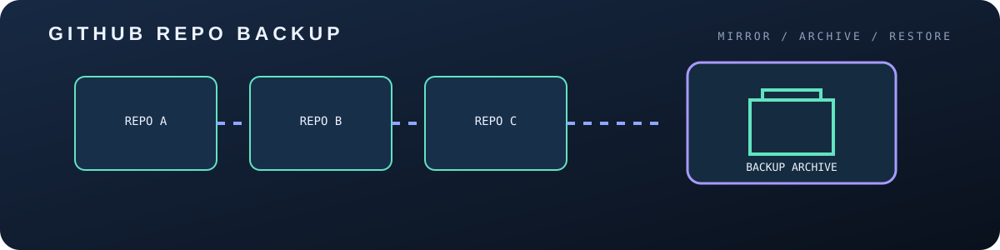

# github-repo-backup

<p align="center"></p>

Back up all your GitHub repositories as full mirror clones with one Python script. Needs only Python 3.8+ and `git` — no third-party packages.

## Features

- Backs up every repo you own (public + private) or an organization's repos
- Full `git clone --mirror` (all branches, tags, refs)
- Incremental: existing backups are updated with `git remote update`
- Optional filters: skip forks, skip archived, include/exclude by name
- Optional `.tar.gz` archive per repo
- Token read from an environment variable (never stored)

## Setup

1. Create a GitHub token (classic with `repo` scope, or fine-grained with read access to contents).
2. Export it:

```bash
export GITHUB_TOKEN=ghp_xxxxxxxxxxxx
```

## Usage

```bash
# back up all your repos into ./backups
python backup.py

# custom folder, skip forks and archived repos
python backup.py --dest ~/gh-backups --skip-forks --skip-archived

# an organization
python backup.py --org my-org

# only some repos, plus tar.gz archives
python backup.py --include "site-*" --archive
```

## Options

| Option | Description |
|---|---|
| `--dest DIR` | Backup folder (default `./backups`) |
| `--org NAME` | Back up an organization instead of your account |
| `--skip-forks` | Ignore forked repos |
| `--skip-archived` | Ignore archived repos |
| `--include PATTERN` | Only repos matching glob (repeatable) |
| `--exclude PATTERN` | Skip repos matching glob (repeatable) |
| `--archive` | Also create a `.tar.gz` of each mirror |

## Automate (cron)

```cron
0 3 * * * GITHUB_TOKEN=ghp_xxx /usr/bin/python3 /path/to/backup.py --dest /backups
```

## License

MIT